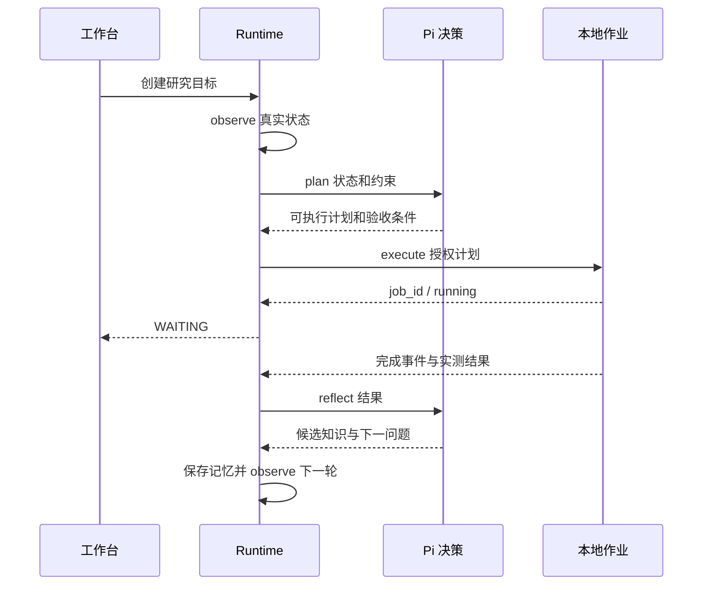

# 本地科研自主任务 API

## 接口元信息

| 项目 | 内容 |
| --- | --- |
| 接口标识 | `POST /api/tasks`、`POST /api/tasks/:id/commands`、`GET /api/tasks/:id/conversation`、`GET /api/tasks/:id/events`、现有 interventions 接口 |
| 用途 | 创建、观察、暂停与继续本地科研自主任务 |
| 调用方 | 桌面工作台；兼容客户端 |
| 提供方 | Yunfeng Server，`server/src/research/` |
| 稳定性 | 实验性 |
| 引入版本 | 0.1.0，2026-10-15 |
| 维护方 | Yunfeng Server |
| 接口类型 | 既有 HTTP/SSE API |
| 调用方式 | 本机 Server 的 `/api` 前缀；网关转发沿用现有约定 |
| 权限或认证 | 本机 Server 沿用现有访问规则；网关使用既有 Bearer 认证；实验动作额外校验任务权限或计划授权 |
| Content-Type | 请求与普通响应 `application/json`；事件 `text/event-stream` |

## 请求

创建任务沿用 `POST /api/tasks`，以下字段用于科研模式。

| 字段 | 位置 | 类型 | 必填 | 默认值 | 约束 | 说明 |
| --- | --- | --- | --- | --- | --- | --- |
| mode | body | string | 否 | development | development / research | 科研模式进入自主 Runtime |
| cwd | body | string | 否 | Server 当前目录 | 必须为存在的目录 | 以真实路径作为项目与记忆范围 |
| message | body | string | 科研时是 | — | 非空，最多 10000 字符 | 原始目标；不会因反思自动替换 |
| model | body | object | 否 | Lin 设置选择的模型 | provider、modelId 字符串 | Pi 决策模型 |
| maxCycles | body | integer | 否 | 20 | 1–1000 轮 | 本次规划预算 |
| permissions.commands | body | object[] | 否 | [] | 最多 20 项；program ≤500 字符；args 最多 32 项，每项 ≤2000 字符，无 NUL | 完整程序和参数精确匹配的预授权命令 |
| permissions.writeRoots | body | string[] | 否 | [".lin/experiments"] | 最多 8 个项目内相对目录，每项 ≤500 字符 | 自动写入范围，不覆盖目录自身 |

科研任务 commands 支持 `abort` 暂停、`retry`/`reopen` 继续、`prompt`/`steer`/`followUp` 补充目标、`setModel` 切换并暂停、`complete`/`archive` 人工关闭，以及空的 `getQueue`/`clearQueue`。补充后的总目标不得超过 10000 字符。人工关闭不表示指标实测通过；以 `autonomy.phase === COMPLETED` 判断自动验收。

批准/拒绝使用既有 `POST /api/tasks/:id/interventions/:requestId/resolve`，body 为 `{"decision":"approve"}` 或 `{"decision":"reject"}`。确认卡展示计划全部步骤、写入内容与验收条件；批准仅适用于该次完整计划，执行或暂停后失效。

## 响应

创建成功返回 HTTP 200，`{task,sessionId}`；普通查询与 commands 沿用既有响应结构。

| 字段 | 类型 | 必定返回 | 约束 | 说明 |
| --- | --- | --- | --- | --- |
| task.mode | string | 科研时是 | research | 调用方无需打开普通 Pi 会话 |
| task.sessionId | string | 是 | research- 前缀的外层运行标识 | 不是 Pi JSONL 会话 ID |
| task.autonomy | object | 科研时是 | schemaVersion 为 1 | TaskStore 的检查点摘要 |
| autonomy.goal | string | 是 | ≤10000 字符 | 当前研究目标 |
| autonomy.phase | string | 是 | OBSERVING / PLANNING / EXECUTING / WAITING / REFLECTING / PAUSED / COMPLETED / FAILED | 自主阶段 |
| autonomy.cycle、maxCycles | integer | 是 | 轮次 | 已用与当前上限 |
| autonomy.reason | string | 是 | 文本 | 当前阶段依据或错误 |
| autonomy.plan | object | 否 | decision、reason、steps、success_condition、observe_paths | 最近计划；观察文件最多 8 个 |
| autonomy.jobId、approvalId | string | 否 | 活跃时提供 | 作业或待授权请求 |
| autonomy.result、lastResult | object | 否 | job_id、status、output、evaluation、completedAt | 当前待反思或上一作业结果 |
| autonomy.learning | object | 否 | summary、knowledge_update、next_question | 最近候选学习；最多 8 条知识更新 |
| autonomy.permissions | object | 是 | 同请求清单 | 当前执行范围 |

`observation` 完整事实保存在服务端检查点，不通过任务摘要返回。作业 status 为 running / succeeded / failed / cancelled / interrupted。验收引用项目普通文件，或 JSON 有限数值字段与 `>`、`>=`、`<`、`<=`、`==` 的比较；数值字符串不算达标。

科研 conversation 返回 `{context:{messages,entryIds}}`，内容来自已有任务事件；SSE 的 `message_completed` 带 `{message:{id,role,content}}`，`task_updated` 带检查点摘要。断线补发继续沿用事件 seq；客户端按消息 ID 去重。capabilities 仅列出 observe、plan、execute、reflect。

## 错误码

| 代码 | 含义 | 可重试 | 处理建议 |
| --- | --- | --- | --- |
| 400 / bad_request | 无效 mode、缺失目录、非法 commands 或 decision | 修正后 | 更正请求字段 |
| 404 / task_not_found | 任务不存在 | 否 | 刷新列表 |
| 404 / intervention_not_found | 授权不存在、已处理或暂停后失效 | 否 | 等待新的具体计划 |
| 500 / task_create_failed | 项目不是目录、目标/权限/预算无效、容量满或初始化失败 | 条件满足后 | 查看 message，修正配置或释放容量后重试一次 |
| 500 / command_failed | 科研不支持该命令、补充目标过长或容量满 | 条件满足后 | 更正命令；保留检查点后手动继续 |

模型输出无效、决策超时或执行提交失败通过 FAILED 阶段报告，HTTP 创建成功不代表随后实验成功。禁止客户端自动无限重试创建或继续。

## 权限与安全

Pi 从 Lin 目录读取模型配置与认证。每次计划/反思使用临时无工具会话，禁用扩展、技能、上下文文件和提示模板。模型不能直接访问文件或执行系统命令；文件内容作为观察数据传入。

读取和写入路径限制在项目内，拒绝符号链接、`.git`、`node_modules`、环境变量文件、认证文件和私钥；路径校验并非抵御并发恶意替换的操作系统沙箱。命令使用 `shell:false` 和参数数组，获准程序仍具有本机权限，也可访问项目之外的系统资源。不要将凭据写入目标、参数、观察文件或输出；计划、结果和候选经验会持久化。

## 行为约束

- 执行器返回作业身份后进入 WAITING，完成事件唤醒反思；文件等待监听项目根及最多三个路径的既有父目录，优先验收路径，再按 observe_paths 顺序，空余位置监听 `.lin/experiments`。监听不递归；订阅后回读一次关闭事件间隙，等待期间不周期调用模型。
- 单服务最多 4 个活跃自主任务与 4 个作业，计划每次最多 8 步并顺序执行。每次计划/反思 120 秒超时，作业总时限 30 分钟；输出保留最后 65536 字符，观察与单次写入文件限制 64 KiB。
- 默认预算 20 轮；用完后暂停。继续时将上限提升至至少当前轮次加 20。成功完成实验后先反思，再根据同一目标规划；只有完成决定通过实测验收才结束。
- 暂停取消当前决策与作业并关闭监听。POSIX 回收命令进程组；Windows 当前仅保证直接子进程，后代进程需后续原生验证。已完成的文件写入不会回滚。
- 检查点先于副作用保存。服务异常重启时未知作业标记 interrupted 并暂停，继续后先反思，禁止自动重放命令。正常关闭也保存暂停状态。无作业、无待授权的活动检查点可在服务恢复时继续，容量之外的任务暂停。
- 创建没有幂等键，重复调用产生不同任务；授权按请求 ID 校验，旧请求不能复用。memory.read 映射既有 MemoryService.retrieve，memory.write 映射 add；反思将知识写为候选 episode，按 job_id 去重，不自动确认候选。
- 仅实现本地项目：文件、Git、任务、基础系统内存与实验结果。GPU、传感器、issue 服务与训练平台未接入，不能推定其状态。没有新增线程池或第三方运行时依赖。



## 调用示例

以下为契约示例；可控决策下的真实本地作业已由核心测试覆盖，真实模型输出质量需独立验收。

```json
{"mode":"research","cwd":"/example/project","message":"核验实验 accuracy 至少 0.93","maxCycles":20}
```

模型 plan 示例：

```json
{"decision":"complete","reason":"项目结果已存在，进行实测核验","steps":[],"success_condition":{"kind":"metric","path":".lin/experiments/metrics.json","key":"accuracy","operator":">=","value":0.93}}
```

暂停：`POST /api/tasks/:id/commands`，body `{"type":"abort"}`；继续：相同接口，body `{"type":"retry"}`。

## 兼容性与变更记录

新增可选 mode 与科研检查点，默认开发模式保留既有调用行为。TaskState 的检查点 schemaVersion 为 1，不迁移旧数据，也不将科研运行身份交给 Pi 会话接口。客户端需容忍可选字段；移动端尚未增加科研专用控制面板。废弃计划：无。

| 日期 | 版本 | 变更类型 | 内容 | 迁移说明 |
| --- | --- | --- | --- | --- |
| 2026-10-15 | 0.1.0 | 兼容 | 本地科研自主任务、检查点、事件、计划授权 | 既有调用无需迁移；新客户端显式选择 research |
