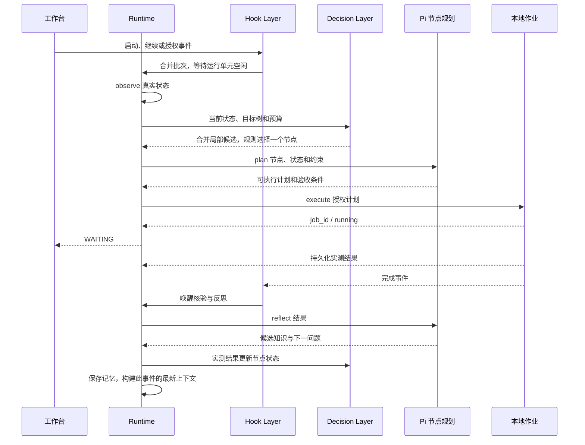

# 本地科研自主任务 API

## 接口元信息

| 项目 | 内容 |
| --- | --- |
| 接口标识 | `POST /api/tasks`、`POST /api/tasks/:id/commands`、`GET /api/tasks/:id/conversation`、`GET /api/tasks/:id/events`、现有 interventions 接口 |
| 用途 | 创建、观察、暂停与继续本地科研自主任务 |
| 调用方 | 桌面工作台；兼容客户端 |
| 提供方 | Yunfeng Server，`server/src/research/` |
| 稳定性 | 实验性 |
| 引入版本 | 0.1.0，2026-10-15 |
| 维护方 | Yunfeng Server |
| 接口类型 | 既有 HTTP/SSE API |
| 调用方式 | 本机 Server 的 `/api` 前缀；网关转发沿用现有约定 |
| 权限或认证 | 本机 Server 沿用现有访问规则；网关使用既有 Bearer 认证；实验动作额外校验任务权限或计划授权 |
| Content-Type | 请求与普通响应 `application/json`；事件 `text/event-stream` |

## 请求

创建任务沿用 `POST /api/tasks`，以下字段用于科研模式。

| 字段 | 位置 | 类型 | 必填 | 默认值 | 约束 | 说明 |
| --- | --- | --- | --- | --- | --- | --- |
| mode | body | string | 否 | development | development / research | 科研模式进入自主 Runtime |
| cwd | body | string | 否 | Server 当前目录 | 必须为存在的目录 | 以真实路径作为项目与记忆范围 |
| message | body | string | 科研时是 | — | 非空，最多 10000 字符 | 原始目标；不会因反思自动替换 |
| model | body | object | 否 | 项目环境或 Lin 默认模型 | provider、modelId 字符串 | 当前节点的 Pi 规划/反思模型 |
| decisionModel | body | object | 否 | 同 model；未指定时使用默认模型 | provider、modelId 非空，分别 ≤200 字符 | 独立决策模型，用于目标树局部提案；可配置小模型 |
| decisionBudget | body | number | 否 | 10 | 有限数值，0 < 值 ≤1000 | 相对估计成本总预算；不表示金额或 GPU 时间 |
| maxCycles | body | integer | 否 | 20 | 1–1000 轮 | 本次规划预算 |
| permissions.commands | body | object[] | 否 | [] | 最多 20 项；program ≤500 字符；args 最多 32 项，每项 ≤2000 字符，无 NUL | 完整程序和参数精确匹配的预授权命令 |
| permissions.writeRoots | body | string[] | 否 | [".lin/experiments"] | 最多 8 个项目内相对目录，每项 ≤500 字符 | 自动写入范围，不覆盖目录自身 |

科研任务 commands 支持 `abort` 暂停、`retry`/`reopen` 继续、`prompt`/`steer`/`followUp` 补充目标、`setModel` 切换并暂停、`complete`/`archive` 人工关闭，以及空的 `getQueue`/`clearQueue`。补充后的总目标不得超过 10000 字符。人工关闭不表示指标实测通过；以 `autonomy.phase === COMPLETED` 判断自动验收。

桌面科研输入框统一以 `prompt` 补充目标，服务端中止当前工作、更新目标后重新观察；暂停与继续集中在状态栏。轮次、运行依据和项目目录通过“运行详情”查看。

任务显式模型优先；未指定时，仓库根 `.env` 的 `YUNFENG_MODEL_PROVIDER` 与 `YUNFENG_MODEL_ID` 优先于 Lin 默认设置。宿主环境变量优先于文件，凭据仅服务端加载，修改后重启后端。`YUNFENG_ENV_FILE` 可指定其他环境文件；不读取 Pi 配置。

批准/拒绝使用既有 `POST /api/tasks/:id/interventions/:requestId/resolve`，body 为 `{"decision":"approve"}` 或 `{"decision":"reject"}`。确认卡展示计划全部步骤、写入内容与验收条件；批准仅适用于该次完整计划，执行或暂停后失效。

## 响应

创建成功返回 HTTP 200，`{task,sessionId}`；普通查询与 commands 沿用既有响应结构。

| 字段 | 类型 | 必定返回 | 约束 | 说明 |
| --- | --- | --- | --- | --- |
| task.mode | string | 科研时是 | research | 调用方无需打开普通 Pi 会话 |
| task.sessionId | string | 是 | research- 前缀的外层运行标识 | 不是 Pi JSONL 会话 ID |
| task.autonomy | object | 科研时是 | schemaVersion 为 1 | TaskStore 的检查点摘要 |
| autonomy.goal | string | 是 | ≤10000 字符 | 当前研究目标 |
| autonomy.phase | string | 是 | OBSERVING / PLANNING / EXECUTING / WAITING / REFLECTING / PAUSED / COMPLETED / FAILED | 自主阶段 |
| autonomy.cycle、maxCycles | integer | 是 | 轮次 | 已用与当前上限 |
| autonomy.reason | string | 是 | 文本 | 当前阶段依据或错误 |
| autonomy.plan | object | 否 | decision、reason、steps、success_condition、observe_paths | 最近计划；观察文件最多 8 个 |
| autonomy.jobId、approvalId | string | 否 | 活跃时提供 | 作业或待授权请求 |
| autonomy.result、lastResult | object | 否 | job_id、status、output、evaluation、completedAt | 当前待反思或上一作业结果 |
| autonomy.component | object | 否 | component=research、revision、state、可选 result | execute 发布的任务专属科研展示快照，见下文 |
| autonomy.learning | object | 否 | summary、knowledge_update、next_question | 最近候选学习；最多 8 条知识更新 |
| autonomy.permissions | object | 是 | 同请求清单 | 当前执行范围 |
| autonomy.decision | object | 新任务是；旧任务规划后是 | mission、nodes、horizon、selectedId、budget、reason | 持久化目标树及决策依据 |
| autonomy.decisionModel | object | 否 | 同请求模型 | 显式指定的决策模型 |
| autonomy.trigger | object | 接收首个 Hook 批次后是 | receivedAt、signals，最多 32 项 | 最近触发原因；通知不能充当实测指标 |

`observation` 完整事实保存在服务端检查点，不通过任务摘要返回。作业 status 为 running / succeeded / failed / cancelled / interrupted。验收引用项目普通文件，或 JSON 有限数值字段与 `>`、`>=`、`<`、`<=`、`==` 的比较；数值字符串不算达标。

`decision.mission` 包含 id=mission、objective 和首次确定后锁定的 condition。`nodes` 最多 100 项，每项有 id、parent、objective、kind（group/explore/execute）、priority、confidence、cost、expected_gain、status、attempts，以及执行后的 fingerprint、jobId 和精简 result。节点身份和状态由服务端维护，父节点必须是 mission 或分组，最多四层。status 为 pending/running/succeeded/failed/blocked；分组仅用于目标层级，不单独执行或宣称实测通过。

模型滚动提案引用已有节点 ID 时，只更新尚可尝试节点的评分估计；原目标、父节点、类型、尝试次数和结果不重置。plan 的 write_file.content 必须是字符串，JSON 文件内容须先序列化。JSON 或阶段结构错误最多请求模型纠正一次，仍受同一阶段时限约束；认证或服务错误不触发结构纠正。

收益、成功概率和成本均为 0–1 的模型估计；priority=`expected_gain*0.5+confidence*0.3-cost*0.2`。horizon 为评分最高的最多五个可执行节点 ID；selectedId 是本轮选择。规则仅选择正评分、预算允许、尚未成功且未耗尽两次尝试的节点。预算 spent 在副作用前预留，成功、失败或中断均不退还。反思文本不能改变实测结果。

模型 plan 的 complete 仅验收当前节点；服务端 Plan 可包含 node_id、mission_complete 或 pause，客户端不得通过模型输出直接设置这些字段。整个任务只在锁定的长期验收条件实测通过后结束。没有验收条件、没有候选、需要人工信息、停止探索或出现无效重复时暂停；wait 等待真实事件。补充人工目标时重新建立树，保留已用成本；普通 retry 不重置尝试次数、预算或验收条件。

科研 conversation 返回 `{context:{messages,entryIds}}`，内容来自已有任务事件；SSE 的 `message_completed` 带 `{message:{id,role,content}}`，`task_updated` 带检查点摘要。断线补发继续沿用事件 seq；客户端按消息 ID 去重。capabilities 仅列出 observe、plan、execute、reflect。

计划、决策评分与作业原始输出属于 `role=tool` 的过程记录，对话默认过滤。`role=assistant` 仅播报实际实验结论、失败后的处理事项与一次最终验收通知；无副作用的中间核验不追加反思消息。反思与下一问题仍写入检查点和候选记忆。用户消息保留。历史快照将旧助手角色的固定过程前缀映射为 tool，不改写原事件；客户端过滤旧 SSE 补发的对应前缀、历史自动追问、连续同文结论和紧接实验结论的完成流程复述。运行卡显示简短阶段进展，内部依据和目录在详情中查看；失败、人工问题与具体计划授权保持可见。

`trigger.signals` 每项包含 hook、reason、event。event 有 id、occurredAt，以及 kind：lifecycle（action=started/resumed/recovered）、files_changed（最多八个项目内 paths）、job_completed（jobId、status）、approval_granted（requestId）。这些事件来自受信任的本地适配器；没有新增 HTTP 事件注入接口。Hook 筛选通知，Context Builder 重读真实状态，Decision Layer 判断是否值得行动。具体模块见 [Hook 说明](../../server/src/research/hooks/README.md)。

## 科研组件更新

Pi 计划可加入 `{"action":"update_component","component":"research","patch":{...}}`。沿用原有 execute 作业、授权、取消和顺序执行机制；该步骤计入每计划最多八步。组件身份由 Runtime 绑定当前任务和作业，Agent 不能指定其他 taskId、jobId、验收结果或 revision。

| patch 字段 | 类型 | 必填 | 约束与含义 |
| --- | --- | --- | --- |
| source | string | 是 | 项目内 JSON 报告相对路径，≤500 字符；普通文件≤64 KiB，沿用敏感路径与符号链接校验 |
| progress | object | 否 | `{label,current,total?,unit?}`；current/total 是报告字段路径，读取有限数值；current≥0，total>0 且 current≤total |
| metrics | array | 否 | 1–6 项 `{label,key,unit?}`，key 读取有限数值；保留原单位和值，百分数不自动乘 100 |
| conclusion | object | 否 | `{summary,details?}`，均为报告文本字段路径；读出的 summary 非空≤500 字符、details 非空≤8000 字符；限制与待办应放在 summary 中保持可见 |

至少提供 progress、metrics、conclusion 中一项。字段路径使用点号，最多200字符，拒绝原型字段；label 最多40字符，unit 最多16字符，文本不得含 NUL。未知字段、数值字符串、直接填写的指标数值和非法进度均原子拒绝。报告应由授权的真实实验生成，组件步骤只读取数据；文件来源可核对，不构成对实验方法或科学结论的独立验证。

一次更新发布 source 中的一份展示快照；省略项在新快照中为空，不拼接旧报告。相同作业、相同数据重复提交不递增版本。返回的 `autonomy.component` 为 `{component:"research",revision,state:{jobId,source,updatedAt,progress?,metrics,conclusion?},result?}`；revision 从1递增，updatedAt 为读取报告的时间。`result` 仅由 Runtime 附加对应作业的真实结果，完成时版本再次递增；后续整体目标核验不会覆盖该实验的节点验收。前端以任务 SSE 快照更新，进度与指标为轻量胶囊，结论摘要保持可见，报告来源、详细过程和作业输出默认折叠。

示例（字段必须已存在于实际报告中）：

```json
{"action":"update_component","component":"research","patch":{"source":".lin/experiments/report.json","progress":{"label":"实验","current":"done","total":"total"},"metrics":[{"label":"体积减小","key":"reduction","unit":"%"}],"conclusion":{"summary":"summary","details":"details"}}}
```

该步骤可在一次实验命令完成后发布，也可在多个授权阶段之间发布进度；当前不会在长命令运行中自动扫描报告，不引入模型轮询。执行时缺失报告、字段校验失败或组件未绑定作业会使作业失败，已完成的前序实验副作用保留，展示快照不被无效数据替换。失败、中断与未通过状态保持可见；已有组件结论时省略同一作业的重复助手结论，内部反思和记忆继续保存。

组件快照与所属任务检查点一同持久化；暂停、继续、重连和重启读取原快照，不重放组件步骤或实验命令。服务重启时未知作业的对应展示标记为中断。组件只读项目报告，不要求扩大命令或文件写入权限，计划内其他动作仍逐项授权。没有新 HTTP 更新端点、Tauri 权限、依赖或跨任务共享存储。

## 错误码

| 代码 | 含义 | 可重试 | 处理建议 |
| --- | --- | --- | --- |
| 400 / bad_request | 无效 mode、缺失目录、非法 commands 或 decision | 修正后 | 更正请求字段 |
| 404 / task_not_found | 任务不存在 | 否 | 刷新列表 |
| 404 / intervention_not_found | 授权不存在、已处理或暂停后失效 | 否 | 等待新的具体计划 |
| 500 / task_create_failed | 项目不是目录、目标/权限/预算无效、容量满或初始化失败 | 条件满足后 | 查看 message，修正配置或释放容量后重试一次 |
| 500 / command_failed | 科研不支持该命令、补充目标过长或容量满 | 条件满足后 | 更正命令；保留检查点后手动继续 |

模型输出无效、决策超时或执行提交失败通过 FAILED 阶段报告，HTTP 创建成功不代表随后实验成功。禁止客户端自动无限重试创建或继续。

模型服务报错时，`autonomy.reason` 包含 decide/plan/reflect 阶段、可识别的 HTTP 状态码与固定诊断。HTTP 401 提示检查 Lin 模型凭据，403 提示账户权限，429 提示稍后手动继续；不返回上游错误正文，避免泄漏凭据与内部地址。

## 权限与安全

决策模型与 Pi 从 Lin 目录读取模型配置与认证。每次 decide/plan/reflect 使用临时无工具会话，禁用扩展、技能、上下文文件和提示模板。Decision Layer 用结构化提案维护树，模型不能直接访问文件或执行系统命令；文件内容作为观察数据传入。

既有模型列表与文件接口将未归档科研任务的项目目录纳入允许根，来源为 TaskStore；无需创建普通 Pi 会话。创建和归档即时生效，目录外路径与符号链接的真实路径校验继续适用。

读取和写入路径限制在项目内，拒绝符号链接、`.git`、`node_modules`、环境变量文件、认证文件和私钥；路径校验并非抵御并发恶意替换的操作系统沙箱。命令使用 `shell:false` 和参数数组，获准程序仍具有本机权限，也可访问项目之外的系统资源。不要将凭据写入目标、参数、观察文件或输出；计划、结果和候选经验会持久化。

## 行为约束

- 执行器返回作业身份后进入 WAITING，结果先持久化再进入作业 Hook。文件 Hook 跟踪最多八个文件，优先长期验收路径、节点验收路径、observe_paths、已观察文件和 README/package.json；最多监听项目根及前三个路径的最近既有父目录，不递归。相同内容和未跟踪文件不唤醒；父目录创建事件重绑，订阅后回读一次关闭观察间隙。监听在工作和等待期间持续保留。
- Hook 队列最多 32 项，最近 128 个通知 ID 去重，文件路径合并最多八项；文件扫描和 Hook 文件派发各有一次性 50 ms 合并窗口，无定时模型轮询。每次只运行一个决策单元，繁忙、作业运行或审批等待时保留通知。排队期间事实已被观察过时跳过模型，不消耗轮次；Decision Layer 选择 wait 时不调用 Pi 规划。
- 单服务最多 4 个活跃自主任务与 4 个作业，计划每次最多 8 步并顺序执行。每次 decide/plan/reflect 120 秒超时，作业总时限 30 分钟；输出保留最后 65536 字符，观察与单次写入文件限制 64 KiB。
- 默认预算 20 轮；用完后暂停。继续时将轮次上限提升至至少当前轮次加 20，成本预算不增加。每轮提出最多五个任务和五个分组，只执行一个节点后重新观察。同一观测文件和 Git 状态下，相同步骤不重复执行，更换验收阈值不能绕过限制；改变项目输入仍受每节点两次限制。节点通过后继续核验长期目标，只有整体实测条件通过才结束。
- 暂停取消当前决策与作业并关闭监听。POSIX 回收命令进程组；Windows 当前仅保证直接子进程，后代进程需后续原生验证。已完成的文件写入不会回滚。
- 检查点先于副作用保存。服务异常重启时未知作业标记 interrupted 并暂停，继续后先反思，禁止自动重放命令。正常关闭也保存暂停状态。无作业、无待授权的活动检查点可在服务恢复时继续，容量之外的任务暂停。
- 最新触发批次随检查点和任务事件记录持久化；排队通知在内存中，恢复 Hook 重新读取状态，不保证离线期间的每个瞬时事件。文件 Hook 出错会暂停任务；任务状态、助手消息不会反向触发思考。审批 Hook 只继续已确认计划。
- 创建没有幂等键，重复调用产生不同任务；授权按请求 ID 校验，旧请求不能复用。memory.read 映射既有 MemoryService.retrieve，memory.write 映射 add；反思将知识写为候选 episode，按 job_id 去重，不自动确认候选。
- 仅实现本地项目：文件、Git、任务、基础系统内存与实验结果。GPU、传感器、issue 服务与训练平台未接入，不能推定其状态。没有新增线程池或第三方运行时依赖。



## 调用示例

以下为契约示例；可控决策下的真实本地作业已由核心测试覆盖，真实模型输出质量需独立验收。

```json
{"mode":"research","cwd":"/example/project","message":"核验实验 accuracy 至少 0.93","maxCycles":20,"decisionBudget":10,"decisionModel":{"provider":"local","modelId":"decision-small"}}
```

模型名为契约示例，实际需在 Lin 模型配置中存在且可用。省略 decisionModel 时沿用任务模型。Decision Layer 提案示例：

```json
{"decision":"select","reason":"先处理低成本的数据问题","mission_condition":{"kind":"metric","path":".lin/experiments/metrics.json","key":"accuracy","operator":">=","value":0.93},"candidates":[{"key":"clean","parent":"mission","objective":"核查错误标签并做对照实验","kind":"explore","confidence":0.8,"cost":0.2,"expected_gain":0.9}]}
```

Pi plan 示例（验收当前选中的节点）：

```json
{"decision":"complete","reason":"项目结果已存在，进行实测核验","steps":[],"success_condition":{"kind":"metric","path":".lin/experiments/metrics.json","key":"accuracy","operator":">=","value":0.93}}
```

暂停：`POST /api/tasks/:id/commands`，body `{"type":"abort"}`；继续：相同接口，body `{"type":"retry"}`。

## 兼容性与变更记录

新增可选 mode 与科研检查点，默认开发模式保留既有调用行为。TaskState 的检查点 schemaVersion 为 1，不迁移旧数据，也不将科研运行身份交给 Pi 会话接口。客户端需容忍可选字段；移动端尚未增加科研专用控制面板。废弃计划：无。

| 日期 | 版本 | 变更类型 | 内容 | 迁移说明 |
| --- | --- | --- | --- | --- |
| 2026-10-15 | 0.1.0 | 兼容 | 本地科研自主任务、检查点、事件、计划授权 | 既有调用无需迁移；新客户端显式选择 research |
| 2026-10-15 | 0.1.0 | 兼容 | 目标树、决策模型、规则评分与预算 | 可选新增字段；旧任务下轮规划时建立树，未知作业恢复规则不变 |
| 2026-10-15 | 0.1.0 | 兼容 | 本地 Hook 层、事件上下文、去重与背压 | 新增可选 trigger；既有 API 不变，旧检查点恢复时重新观察 |
| 2026-10-15 | 0.1.0 | 修复 | 科研任务项目目录识别与模型失败诊断 | 无字段变更；错误原因仅公开固定诊断与状态码 |
| 2026-10-15 | 0.1.0 | 修复 | 项目环境配置、模型结构纠正与滚动节点身份 | 无持久化字段变更；显式任务模型继续优先 |
| 2026-10-15 | 0.1.0 | 修复 | 科研过程消息按工具记录过滤，反思面向用户 | 沿用已有消息角色；历史事件不改写，兼容旧快照与补发 |
| 2026-10-16 | 0.1.0 | 兼容扩展 | execute 发布任务专属科研组件，展示报告进度、指标和结论 | 新增可选 autonomy.component 与计划步骤；旧检查点无需迁移 |

2026-10-16 验证：Server 构建与前端 TypeScript 通过，18 项服务端核心测试和 5 项 React 核心测试通过。macOS 开发应用中，真实 Pi 按 execute 计划发布基线报告（实验 1/2），暂停并重启后快照保留；继续后执行一次优化并发布实验 2/2，压缩体积从 8686 降至 7736 字节（减少 10.94%），解压一致且 completed==1。日志仅有 baseline、optimize 各一次，最终结论由胶囊与报告摘要展示，对话未重复输出同轮反思。原生展开详情、Enter 收起通过；重载时仍存在既有 HTTP 502，需要一次手动重连。其他桌面平台和长命令内的实时报告刷新尚未验收。

### 任务内关系图组件

`POST /api/tasks/:id/components/research-graph` 沿用组件请求形状：

```json
{"action":"focus","component":"research-graph","target":"current"}
```

支持 `read`、`status`、`focus`、`blur`。`target` 为当前任务真实节点 ID、`mission` 或 `current`（服务端解析当前节点）。不存在的节点或跨组件请求返回 HTTP 400；非科研任务返回 404。该接口沿用任务接口的本机访问边界，不访问项目外文件，也不执行实验或改变目标树。

`read` 返回 TaskStore 中的目标树、临时 `focus` 和 `interaction`。`status` 返回 `known/visible/editing/yielded/rendered/renderedRevision/focusedRevision`。`focus` 返回 `accepted`；画布不可见或反馈超过 2.5 秒时拒绝并返回 `INTERACTION_UNAVAILABLE`，工程师操作时返回 `COMPONENT_BUSY`。拒绝不排队。接收不等于已呈现：客户端实际定位后报告 `focusedRevision`；聚焦请求两秒失效，重启不重放。未打开关系图时不自动切换工程师的视图。

UI 通过同一路径提交 `{action:"report",report:{sequence,visible,editing,renderedRevision,focusedRevision,epoch}}`。序号须单调递增，版本不能超过当前任务或已发出的焦点版本；旧反馈忽略，非法反馈返回 400。拖动、缩放、点击和输入立即让出，松手后保留短暂保护，不回放旧请求。报告中的 `epoch` 回传服务提供的 `focus.epoch`（初次为 null），服务重启会更换 epoch，旧聚焦确认随即失效，前端自动重新同步。交互租约仅保存在内存，不写业务检查点；离开关系图上报不可见，断联后自动失效。这里使用有界心跳同步 UI 临时租约，不唤醒科研决策或调用模型。

科研 Agent 通过受控 `execute` 步骤调用：

```json
{"action":"focus_component","component":"research-graph","target":"current"}
```

该步骤计入现有八步上限；返回接收或让出原因进入执行结果，拒绝不会终止实验。observe 的 `component.research-graph` 事实包含交互反馈，遇到让出原因不得立即重试争抢视野。程序可以直接使用上述组件 API；服务端亦提供 `ResearchGraphComponent.client()` 复用 `componentClient`。

每个决策节点可选保存 `report`（科研组件快照）和 `reflection`（本次作业反思摘要），与节点 `jobId` 绑定。报告仍只允许从授权的真实 JSON 产物读取，验收由 Runtime 计算；点击节点显示其进度、指标、结论，执行原文和决策估计默认折叠。旧检查点无这些字段时显示无指标报告及已有验收，不从最新的其他实验补造数据。新字段可选，无需迁移旧任务。
