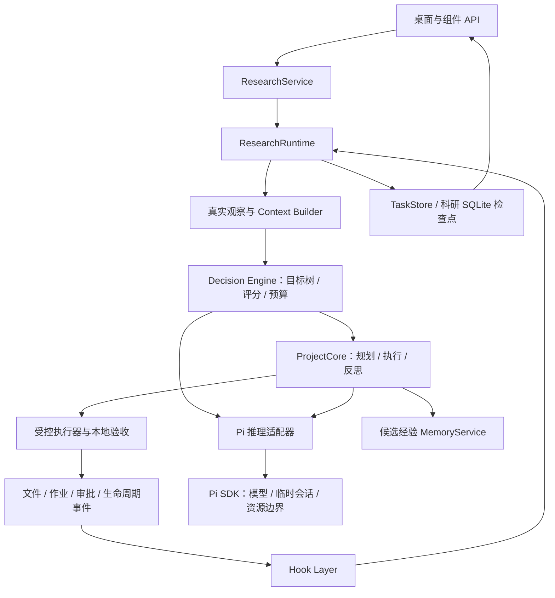

# 科研模式：Pi SDK 与自研 Runtime 的边界

状态：已确认的架构方向；下表记录 2026-10-18 的实际实现。

科研模式以 Pi SDK 提供的嵌入式模型、会话和资源能力为底座，由 Yunfeng 自研长期自治系统。任务生命周期、目标树、权限、实验作业、验收和持久化由宿主掌管。Pi 会话生命周期与科研任务生命周期分别管理。

当前实现保留 TS 编排与 Rust 执行的分层：Runtime、Decision Engine、Pi SDK、任务生命周期和存储沿用 TS；有界文件观察、连续写入与指标验收复用桌面 Rust 私有通道。优化以减少往返、固定缓冲与有界批次为主，未将科研 Agent 整体迁入 Rust。接口与取消/部分提交边界见 [执行契约](../api/2026-10-18-research-execution.md)。

## 依赖与职责

| 模块 | Yunfeng 负责的行为 | 当前入口 |
| --- | --- | --- |
| Mission / Task | 长期目标、节点状态、验收条件、预算 | `research/types.ts`、`decision/` |
| Hook / Context | 合并唤醒事件、重新观察真实事实、过滤无变化事件 | `hooks/`、`context.ts`、`project.ts` |
| Decision | 滚动候选、规则评分、选择下一节点、等待或请求人工处理 | `decision/engine.ts` |
| Runtime | 串行阶段编排、暂停恢复、检查点、作业完成后续接 | `runtime.ts`、`service.ts` |
| Execution / Evaluation | 权限和计划校验、启动实验、取消回收、读取真实验收结果 | `executor.ts`、`project.ts`、`validation.ts` |
| Memory | 保存反思与候选知识，区分推断和实测事实 | `core.ts` 与既有 MemoryService |
| Presentation | 发布报告字段、图节点摘要、呈现反馈、人工操作让出控制 | `components.ts`、`graph-component.ts` |
| Pi 适配 | 模型选择、阶段提示契约、临时会话、取消、解析和有限纠错 | `reasoner.ts`、`agent/sdk.ts` |

表中路径相对 `server/src/`。领域层交换 `State / Plan / Result / Learning` 与结构化推理结果；Pi 的会话、事件和消息类型留在适配边界。领域实现可注入 `Reasoner`，便于使用可控模型验证流程。

## 使用 SDK 的方式

当前依赖 `@earendil-works/pi-coding-agent` **1.2.0** 的嵌入式 SDK。包同时包含编码 CLI 和 SDK 导出，科研服务调用 `createAgentSessionFromServices` 在 Server 进程内创建会话。后续开发继续复用 SDK 的模型访问、认证、会话和资源接口，避免重复实现已有基础能力。

`agent/sdk.ts` 统一适配 `.lin/agent` 配置；科研模型会话使用 `SessionManager.inMemory(cwd)`，显式禁用工具和资源自动发现；选中的 skill 与内置事件扩展通过 `resources.ts` 接入。`reasoner.ts` 处理 decide、plan、reflect、relate、summarize，每次返回经过验证的结构化结果，最后释放会话。临时模型上下文由任务事实和检查点构建；科研长期状态由 TaskStore 保存。

所有产生副作用的实验动作继续通过 `ProjectCore.execute` 与受控执行器。模型提交计划后，宿主验证权限、执行并独立验收。SDK 的工具调用循环、队列和会话事件仅描述一次模型工作，不能直接决定科研任务完成、增加预算或恢复未知作业。

SDK 文档说明 `agent_end` 仅结束一次底层运行，自动重试或排队工作可能继续。需要订阅会话真正安定的通知时，使用文档中的 `agent_settled`；当前适配器等待 `session.prompt()` 并检查最终消息。实验完成仍以本地作业结果和验收为准。

## 持续扩展的约束

工具数量、调用权重与执行前仲裁遵循 [工具设计原则](2026-10-18-tool-design-principles.md)。统一权重与仲裁尚待实现，现有权限和步骤依赖继续作为硬约束。

1. Hook 负责唤醒，Decision Engine 判断是否值得行动；没有新事实时进入 WAITING。暂停状态、恢复条件和资源预算继续由 Runtime 管理。
2. Skill、上下文和扩展由宿主显式选择、控制信任和大小，再经 SDK 资源接口接入。当前支持创建任务时显式选择最多五个 skill，并将有界方法文本注入资源上下文；辅助脚本和引用文件不自动装载，磁盘扩展不自动运行。
3. 新增实验、训练或实体设备能力通过受控执行适配器接入，完成与异常转换为 Hook 事件。当前已接入本地文件、作业、审批和生命周期事件；机器人与外部训练事件适配器尚未实现。
4. Pi 扩展事件需要转换成宿主事件后再进入 Hook 层，明确来源、去重和任务归属。当前 `PiResearchBridge` 转换生命周期通知但禁止其唤醒自身；`research:changed` 仅通知已观察文件变化，经过 Hook 合并与真实内容门控后再唤醒。
5. 模型建议与本地确定性校验分别负责提案和约束。词向量只用于相关性召回；图关系、标题和摘要的调整继续经过服务端校验与保存。
6. UI 审阅页的闭环样例用于体验状态和动画。真实 Runtime、真实模型和实验作业分别按实际运行证据验收。

增加能力时先查所用版本的 SDK 文档和导出声明，确认可复用的基础能力，再实现宿主的科研领域逻辑。升级 SDK 时重点核对模型配置、资源发现、会话释放、取消、最终事件与结构化输出隔离；不得默认继承 CLI 的工具和项目资源。

## 文档与验证入口

- [Pi 官方 SDK 文档](https://github.com/earendil-works/pi/blob/main/packages/coding-agent/docs/sdk.md)：嵌入、会话生命周期、资源和工具注入；主分支可能超前于本项目版本。
- 安装版本依据：`server/node_modules/@earendil-works/pi-coding-agent/docs/sdk.md`、同包 `package.json` 与导出声明；执行命令时从仓库根定位。
- [科研模块说明](../../server/src/research/README.md)与[科研 API](../api/2026-10-15-research-runtime.md)。
- [真实模型与本地源码压缩实验验收记录](2026-10-15-research-acceptance.md)。
- 核心流程：在 `server/` 执行 `pnpm exec tsx --test test/research-runtime.test.ts test/research-decision.test.ts test/research-hooks.test.ts`。可控模型测试用于验证编排和恢复；真实模型效果需要独立实测。

## 2026-10-18 代码验证

`research-resources.test.ts` 使用实际 SDK 1.2.0 与本地模型替身，选择单个 skill，验证未选中文本和项目扩展不被载入，模型请求没有工具。真实 Node 作业读取 Runtime 源码并执行 gzip：level=1 为 3012 字节，level=9 为 2796 字节，减小约 7.17%，解压字节一致。先等待文件前置条件，基线结束后反思并等待人工复核；暂停、重建服务后恢复优化，日志核对两个阶段各执行一次，组件报告验收通过。数字取决于本次源码版本；模型替身只验证接线和阶段契约，不作为真实模型研究能力的证据。
